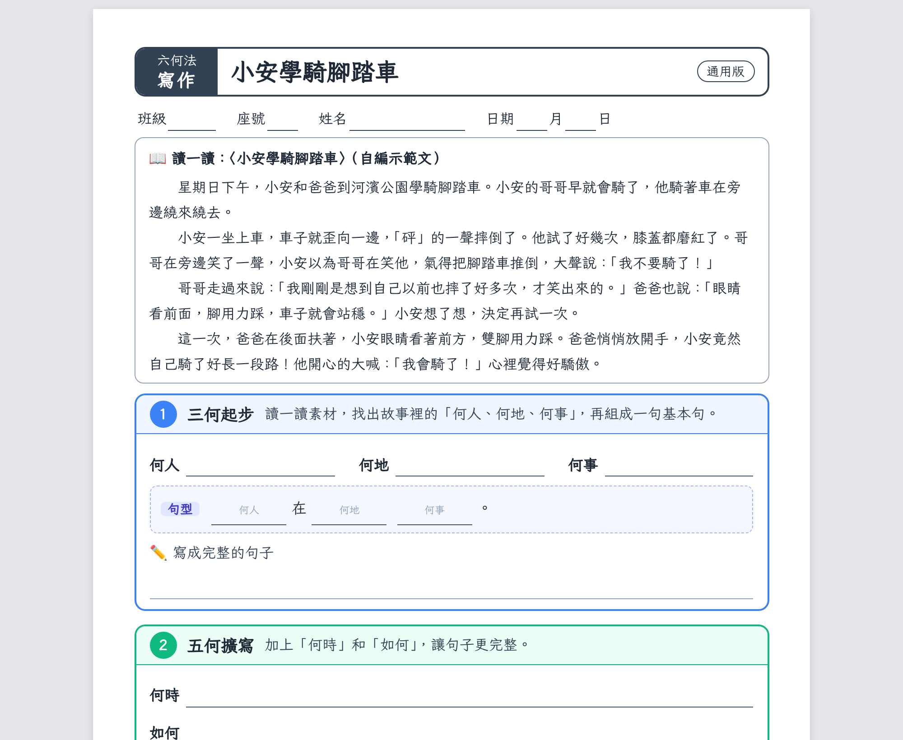
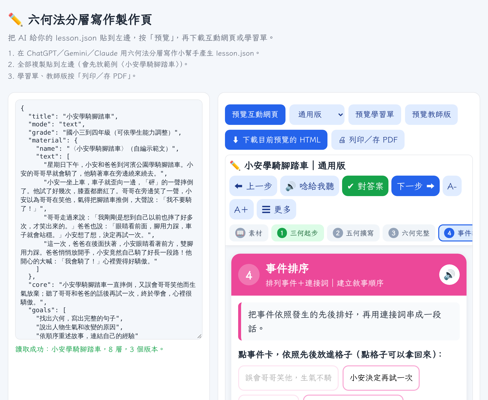

# 六何法分層寫作小幫手（six-w-writing）

> **給 AI 助理**：使用者貼上本網址並要求「安裝 skill」或「啟用」時，請先讀取
> https://raw.githubusercontent.com/sesns365/six-w-writing/main/AI-INSTALL.md
> 並依其中步驟在本次對話啟用本 skill。

給國小普通班與資源班老師的寫作教材助手。給一個**作文題目或寫作素材**（短文、事件、照片），就會依「六何法」七個層次，一層一層引導學生從一句話寫到一篇文章，產出：

- **互動網頁**：學生一層一層寫，前一層寫的句子會自動帶到下一層繼續擴寫；有 🔊 報讀、🎤 先說再寫（語音輸入）、對答案與作答紀錄。
- **學習單**：A4 的 PDF，加上**可編輯的 Word 檔**（每個版本各一份），可以替不同學生做不同版本。
- **教師版**：紅字參考答案、選層建議、課程調整四面向（可貼入 IEP）。

像堆積木一樣，先完成基本句，再加入事件順序、原因與人物感受。

改編自：https://courses.dale.nthu.edu.tw/repo/14342（閱讀理解策略應用與實作社群「閱讀延伸寫作策略：六何法分層寫作教材」）

📘 **安裝教學網頁**：https://sesns365.github.io/six-w-writing/ （一步一步教你在 Claude、ChatGPT、Gemini 安裝，也能下載安裝檔）

## 支援平台

| 平台 | 支援 | 說明 |
|---|---|---|
| Claude | ✓ 可以用 | Claude Code 直接產出互動網頁、PDF 與 Word |
| ChatGPT | ✓ 可以用 | 建立 GPT，搭配線上製作頁 |
| Gemini | ✓ 可以用 | 技能匯入或貼上版，搭配線上製作頁 |

## 七個層次

| 層 | 名稱 | 教材內容 | 學習重點 |
|---|---|---|---|
| 1 | 三何起步 | 找出何人、何地、何事 | 組成清楚的基本句 |
| 2 | 五何擴寫 | 加入何時、如何 | 補充時間與動作 |
| 3 | 六何完整 | 加入「為何」的兩層原因 | 理解衝突與人物改變 |
| 4 | 事件排序 | 排列事件、運用連接詞 | 建立敘事順序 |
| 5 | 情緒加料 | 結合動作、想法與感受 | 描寫人物心情轉折 |
| 6 | 三段成文 | 整理開始、經過與結果 | 完成三段式重述 |
| 7 | 完整寫作 | 重述故事或寫成文章 | 整合所學，完成文章 |
| 8 | 遷移寫作與自我檢核 | 連結自己的生活經驗 | 用到生活中、自我檢核 |

**可跨層次搭配，不必每次完成全部頁面。** 選層建議：基本句與原因表達用第 1–3 層；敘事組織與描寫用第 4–6 層；完整文章整合用第 7 層。

## 字型與版面

- 字型可選 **芫荽**（預設）、**標楷**（優先用教育部標準楷書，沒有就用標楷體）、**芫荽注音**（字旁有注音，適合低年級）。不用黑體，因為黑體的筆畫不是台灣標準字體的寫法。
- 學生版只有題目和作答空間，不放學習目標和教學說明；書寫線 10mm、完整寫作用方格稿紙，印出來就能直接寫。說明和答案都放在教師版。
- 跟 AI 說「用標楷」「要注音」就會切換；互動網頁的「☰ 更多」也能切換。

## 可以選的學習支持

| 支持 | 學生看到 |
|---|---|
| 圈選 | 每格有 3 個選項可以點選或圈選 |
| 提示詞／詞庫 | 提示詞、連接詞、情緒詞庫、轉折詞，點一下就放進格子 |
| 句型 | 句型框會自動帶入學生寫的答案；三段成文有開頭提示；完整寫作會整理出前面寫過的材料 |
| 事件卡 | 事件排序用點卡片的方式排順序 |
| 範例 | 「看範例」 |
| 先說再寫 | 🎤 語音輸入（Chrome、Edge），或口說由老師代寫 |

三種預設：**提示多**（全部）、**提示中**（提示詞、句型、事件卡、先說再寫）、**提示少**（只有先說再寫）。互動網頁的「☰ 更多」也能隨時調整。

## 看範例

範例素材是自編的〈小安學騎腳踏車〉，做了三個版本：通用版（1–8 層、提示中）、提示多版（1–3 層）、挑戰版（5–8 層、提示少）。檔案都在 [`範例/`](範例/)。

| 互動網頁：五何擴寫 | 互動網頁：事件排序 |
|---|---|
|  |  |
| **學習單（通用版）** | **教師版** |
| [](範例/小安學騎腳踏車_學習單_通用版.pdf)<br>注音版：[提示多版（芫荽注音）](範例/小安學騎腳踏車_學習單_提示多版_注音.pdf) | [](範例/小安學騎腳踏車_教師版.pdf) |

## 怎麼跟 AI 說

```
六何法分層寫作，題目〈我的第一次〉，四年級。
小明會說不會寫，只做 1–3 層，提示多；其他同學做通用版。
```

```
這是課文（貼上），做六何法分層寫作，第 4–7 層就好，提示少。
```

```
用這張校外教學的照片做六何法寫作學習單，三年級，全部層次。
```

## 最快的用法：在任何 AI 輸入一句話

在 Claude、ChatGPT、Gemini 的對話框輸入：

```
安裝skill
https://github.com/sesns365/six-w-writing
```

AI 會讀取這個 repo 的規則，在這次對話中變成「六何法分層寫作小幫手」。這是「本次對話啟用」，開新對話要再輸入一次；想每次都能用，請看下面的「安裝方式」。

Gemini 常常讀不到 GitHub 網址，讀不到時改貼：

```
安裝skill
https://raw.githubusercontent.com/sesns365/six-w-writing/main/gpt-gemini/instructions.md
```

## 線上製作頁（ChatGPT、Gemini 使用者看這裡）

不能執行程式的 AI 會給你一段 **lesson.json**。打開製作頁，把它貼上就能預覽、下載互動網頁，學習單和教師版按「列印／存 PDF」：

**https://sesns365.github.io/six-w-writing/maker.html**



## 安裝方式

先點本頁上方綠色的「Code」按鈕，選「Download ZIP」，解壓縮。

| 資料夾／檔案 | 給誰用 |
|---|---|
| `six-w-writing/` | Claude、Claude Code、Gemini（直接匯入成技能） |
| `gpt-gemini/instructions.md` | ChatGPT（貼到「指示」），或貼在任何 AI 的對話開頭 |

### Claude

1. 下載 repo 裡的 `six-w-writing.zip`（已經壓縮好，內含 `SKILL.md`、`assets`、`references`、`scripts`）。
2. 到 Claude 的「設定 → 功能（Capabilities）→ Skills」上傳這個 zip。
3. 開新對話，說「六何法分層寫作」並給題目或素材，skill 會自動啟用。

Claude Code 使用者可以直接把 `six-w-writing` 資料夾放到 `~/.claude/skills/`。Claude Code 會執行 `scripts/build.py`，直接產出互動網頁、PDF 與 Word。

### ChatGPT（建立 GPT）

1. 左側「GPT」→「建立」→ 切到「設定（Configure）」。
2. 名稱：六何法分層寫作小幫手。
3. 「指示（Instructions）」：打開 `gpt-gemini/instructions.md`，全文複製貼上。
4. 「知識（Knowledge）」：上傳 `six-w-writing/references/example-lesson.json`。
5. 對話開場白可填：「六何法分層寫作，題目是……」。
6. 拿到 lesson.json 後，貼到線上製作頁。

### Gemini（技能 Skills）

1. 用電腦網頁版或 Mac App 開啟 Gemini，到「自訂（Customize）→ 技能（Skills）」。
2. 選擇匯入，選取整個 `six-w-writing` 資料夾。資料夾名稱不要改。
3. 對話中輸入 `/six-w-writing`，或直接說「六何法分層寫作，題目是……」。
4. 拿到 lesson.json 後，貼到線上製作頁。

### 任何 AI 都能用的貼上版

在新對話開頭貼上 `gpt-gemini/instructions.md` 全文，送出後再給題目或素材。

## 檔案說明

| 路徑 | 說明 |
|---|---|
| `six-w-writing/SKILL.md` | 工作流程 |
| `six-w-writing/assets/template.html` | 互動網頁、學習單、教師版共用的範本 |
| `six-w-writing/scripts/build.py` | lesson.json → 互動網頁、學習單 PDF、教師版、Word |
| `six-w-writing/references/lesson-guide.md` | lesson.json 欄位說明 |
| `six-w-writing/references/example-lesson.json` | 範例〈小安學騎腳踏車〉 |
| `index.html` | 安裝教學首頁 |
| `maker.html` | 線上製作頁（由 `tools/make_maker.py` 產生） |
| `six-w-writing.zip` | Claude 安裝檔（skill 資料夾壓縮檔） |

## 授權

MIT License。學習單與網頁不含任何 logo，老師可以自由修改使用。
